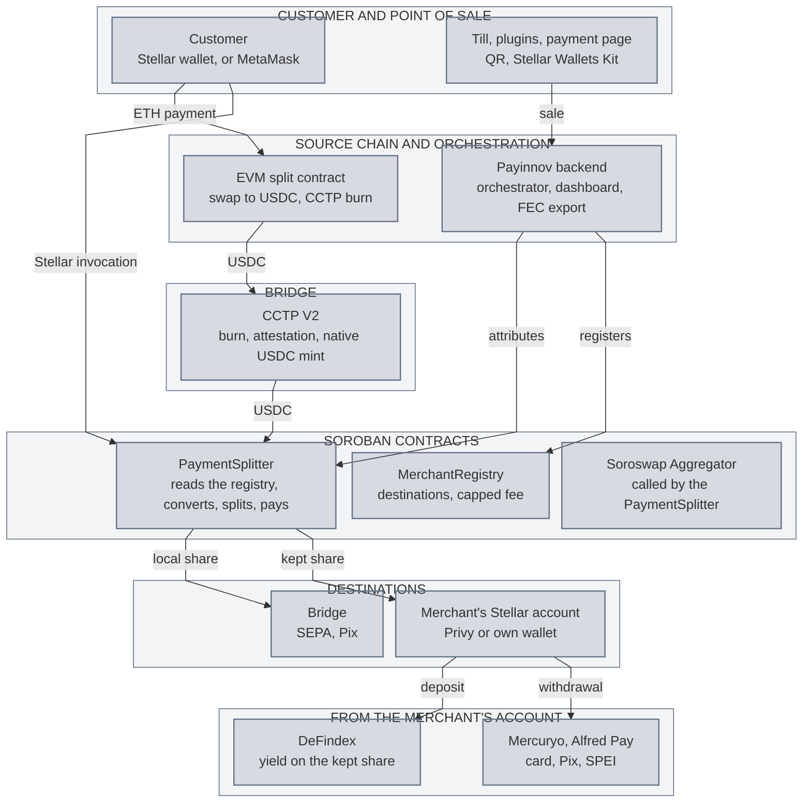
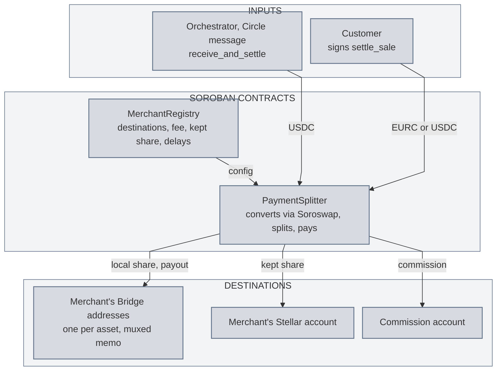
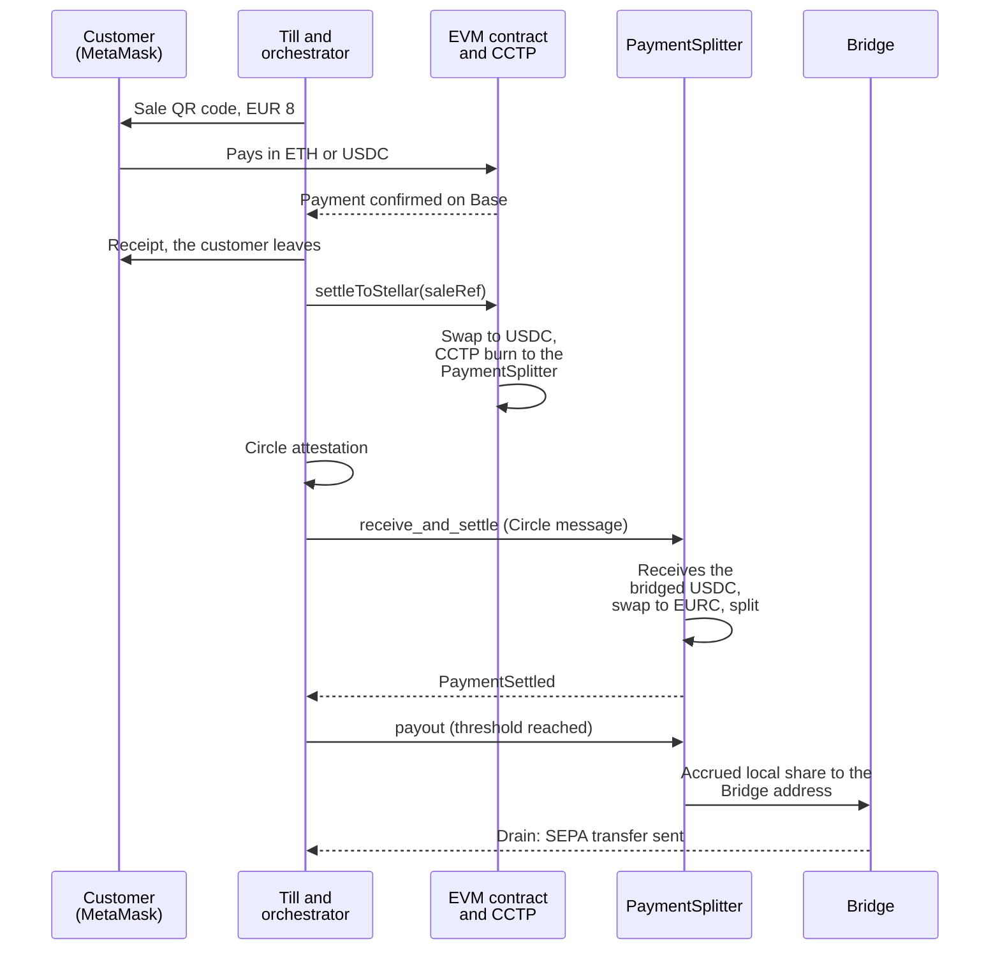

# Payinnov: technical architecture of settlement on Stellar

This document has two parts. The first explains what we are building and the path the money takes. The second is the technical annex: contracts, accounts, integrations, threat model, tests.

## 1. Summary

Payinnov lets a merchant accept crypto and stablecoin payments, in store (an app on the Android payment terminals they already own, an iOS app) and online (WooCommerce, PrestaShop and Magento plugins, API and widget). The customer scans a QR code and pays from their own wallet; a split contract receives the sale, takes our commission and pays the rest to the merchant. Nobody holds the funds in between. The platform has been in production with French merchants since 2023.

We are moving **settlement** to Stellar. Today, every sale is converted to euros one at a time by a single provider, MoonPay, at 1% plus an FX spread, paid out in one to three business days, in euros, dollars or pounds only. Tomorrow, every sale ends with an invocation of a **Soroban contract** that converts into the asset the merchant has chosen (EURC for a euro merchant, USDC for a dollar merchant), splits, and pays out: the share they want in local currency goes to **Bridge**, which wires it in euros, reais, pesos or pounds; the share they keep in crypto goes to **their Stellar account**, from which they can withdraw through **Alfred Pay** or **Mercuryo**, or put it to work on **DeFindex**. A customer with a Stellar wallet (Lobstr, xBull, Freighter) pays the contract directly; a customer paying in ETH or USDC on another chain carries on exactly as today, and their payment reaches Stellar through **CCTP**.

| Building block | Role at Payinnov |
|---|---|
| Soroban (MerchantRegistry, PaymentSplitter) | The settlement contract: it receives every sale, converts, splits and pays out, under rules nobody can bypass |
| Stellar Wallets Kit | A customer pays the contract from their Stellar wallet, online and in store (xBull, Freighter, Hana, Albedo, Lobstr via WalletConnect) |
| CCTP V2 (Circle) | A payment received in ETH or USDC on Ethereum, Base, Polygon or Sonic lands on Stellar as native USDC, no wrapped token |
| Soroswap Aggregator | Conversion between USDC and EURC inside the invocation, into the merchant's chosen asset, at the best price across Soroban pools, minimum amount guaranteed |
| Privy | A Stellar account for every merchant behind their usual login; a crypto-savvy merchant connects their own wallet instead |
| Bridge (Stripe) | Payout in euros (SEPA), reais (Pix), Mexican pesos (SPEI), pounds or Colombian pesos from the merchant's USDC or EURC, converted on receipt |
| Mercuryo | Card payout for sole traders and merchants outside the SEPA zone |
| Alfred Pay | Payout in reais (Pix) and pesos (SPEI) for merchants in Brazil and Mexico |
| DeFindex | Yield on the share the merchant keeps in crypto, from the dashboard |
| Stellar RPC | Detection of every sale through the contract event, confirmation at the till, accounting export |

**What Stellar brings.** One settlement rail for every payment method we accept: whatever the customer pays with, the sale ends with a Soroban invocation and a stablecoin payment, final in five seconds for less than a cent. The network's ramps cover the last mile in the merchant's currency, where our current provider stops at the euro. And the merchant who wants nothing to do with crypto only ever sees their own currency on their bank account the next day.



## 2. Why Stellar

- **Native euro and dollar.** Our merchants today are euro businesses; Brazilian and Mexican ones are next. On Stellar, Circle's EURC and USDC settle in five seconds for less than a cent, the merchant picks which of the two they are settled in, and Bridge wires euros straight from EURC with no currency conversion. One FX conversion in the whole chain, instead of one per sale at MoonPay.
- **The settlement contract does everything in one invocation.** Receive, convert at the best pool price, split between merchant, platform and payout rails, emit the event that confirms the sale: all or nothing, in the same transaction. That is what lets us stay out of the path of the money.
- **The ramps follow our expansion map.** Bridge for Europe and Brazil, Alfred Pay for Brazil and Mexico, Mercuryo for cards: all plugged into the same asset, from the same account.
- **Our other chains become entry points.** With CCTP, the payments we already receive in ETH or USDC on Ethereum, Base, Polygon and Sonic join Stellar instead of competing with it.
- **The merchant never needs XLM.** Sponsored reserves, fees covered, amounts displayed in euros.

## 3. The path of the money

### 3.1 Who holds what

Nothing changes in the principle our product has rested on from day one: funds go from the customer to the merchant through a contract, and nobody holds a key that could divert them. On Stellar, that principle is written into the PaymentSplitter:

- the contract can only pay the destinations registered for the merchant in the MerchantRegistry: their Bridge address (local-currency share), their Stellar account (share kept in crypto), our commission account;
- the commission is capped in code at 5%, above our most expensive plan; no administrator can exceed it, nor set the merchant to zero;
- only the owner of the registered Stellar account can change the destinations, Bridge address included, and the kept share, with their own signature; no Payinnov role can;
- a fee change by Payinnov only applies to future sales, after a 24-hour delay announced by an on-chain event;
- the emergency pause stops sales, it never allows funds to be withdrawn; a code upgrade goes through a 48-hour delay announced on-chain.

Payinnov holds an **attribution** role: when a payment arrives through CCTP, our orchestrator presents the contract with Circle's message and the sale it belongs to. It cannot change its destination: the contract always pays according to the registry. The local-currency share accrues inside the contract in the merchant's name and goes out to Bridge as soon as it reaches a threshold (a few tens of euros, set by the merchant) or once a day; held in the merchant's settlement asset, that wait carries no FX risk.

### 3.2 The merchant and their settings

At onboarding, every merchant gets a Stellar account and their settings:

1. **Their Stellar account.** Created behind their usual login (Privy) if they are new to crypto; or their own wallet (Lobstr, xBull, Freighter) connected through the Stellar Wallets Kit if they have one. Reserves and trustlines are paid by Payinnov.
2. **Their settlement asset**: EURC or USDC, their choice. A euro merchant picks EURC; a dollar merchant, or one whose local currency has no stablecoin on Stellar, picks USDC. The contract converts every sale into that asset.
3. **Their local-currency payout address.** After Bridge's business verification (hosted link, a few days), Bridge assigns them one Stellar address per asset (one for EURC, one for USDC), tied to their bank account: IBAN, Pix key, Mexican CLABE, UK or Colombian account. Everything that lands there is converted and wired in their currency. The merchant confirms these addresses in their dashboard, with their signature: they write them into the registry, not Payinnov. Merchants in Brazil and Mexico can also go through Alfred Pay, sole traders through Mercuryo (section 10).
4. **Their share kept in crypto**, from 0 to 100%, in their settlement asset. Pro plan: 0% by default, everything goes out in local currency. The merchant moves the slider from their dashboard, with their signature.

The merchant who wants nothing to do with crypto never touches the slider: they receive euros, reais or pesos on their bank account the day after each sale, as with a card terminal.

### 3.3 The flows

- **Customer with a Stellar wallet, online.** The payment page opens the Stellar Wallets Kit; the customer signs a `settle_sale` invocation that transfers exactly the amount requested, in the merchant's settlement asset, and settles the sale.
- **Customer with a Stellar wallet, in store.** The QR code at the till opens the same payment page on their phone; Lobstr connects through WalletConnect and signs the same invocation.
- **Customer paying in ETH or USDC on Ethereum, Base, Polygon or Sonic.** They pay our EVM split contract as today and leave. Then anyone can trigger, for that sale, the swap to USDC and the CCTP departure to Stellar, in a single transaction; our orchestrator does it and pays the gas. On arrival, the orchestrator presents Circle's message to the PaymentSplitter, which receives the USDC and settles the sale in a single invocation.
- **Customer whose Stellar wallet cannot sign an invocation.** There is no direct-payment path to the merchant's account: they pay through the EVM chain as today. Every wallet in the Stellar Wallets Kit signs invocations.

## 4. What exists today

- App for Android terminals, iOS app (App Store, June 2023, last update March 2025), WooCommerce, PrestaShop and Magento plugins, REST API and widget, merchant dashboard with the French statutory accounting export (FEC).
- Payment in ETH, BNB, USDC and other EVM assets, Solana; one QR code per sale; the backend checks settlement on-chain and confirms the sale; an EVM split contract takes the commission.
- Seven merchants in France, EUR 1.57M in crypto payments per year; conversion to euros by MoonPay at every sale for Pro-plan merchants.

The checkout layer stays as it is. Stellar replaces the settlement and payout layer underneath it.

## 5. System architecture

| Layer | Component | What it does |
|---|---|---|
| Customer and point of sale | Till, plugins, API, payment page | Creates the sale and its QR code; the payment page builds the invocation and gets it signed by the customer's Stellar wallet |
| Payinnov, off-chain | Settlement orchestrator | Triggers the swap and CCTP departure of an EVM sale, follows Circle's attestation, presents the message to the PaymentSplitter, confirms the sale to the till on the event |
| Payinnov, off-chain | Merchant dashboard | Onboarding, Bridge verification, destinations and slider, Mercuryo and Alfred Pay withdrawals, DeFindex deposit, FEC export |
| Source chain | EVM split contract | "Stellar settlement" mode: swap to USDC and `depositForBurnWithHook`, triggerable by anyone, for a given sale |
| Stellar | MerchantRegistry | Each merchant's configuration, capped fee, delayed changes |
| Stellar | PaymentSplitter | Receives, converts via Soroswap into the merchant's settlement asset, splits, pays out, emits `PaymentSettled` |
| Stellar | Merchant accounts | Privy or own wallet; sponsored reserves and trustlines |
| Partners | Bridge, Mercuryo, Alfred Pay, DeFindex | Local-currency payout (SEPA, Pix, SPEI, pounds, Colombian pesos), card, yield |
| Data | Stellar RPC, Horizon | Contract events, confirmation, reconciliation, FEC export |

## 6. Accepting payments

### 6.1 Stellar payment page and Stellar Wallets Kit

The payment page is a web page our plugins and widget already embed for the other chains. It gains a "Pay with a Stellar wallet" button that opens Stellar Wallets Kit v2 (distributed on JSR, `@creit-tech/stellar-wallets-kit`): xBull, Freighter, Hana, Albedo, and Lobstr via WalletConnect 2.0 on mobile. The page builds the transaction (`@stellar/stellar-sdk` v16, Stellar RPC for simulation and submission), the wallet signs it. Before signing, the page checks the network passphrase, the contract address and the customer's trustline on the asset being paid.

In store, the QR code at the till encodes the URL of this page with the sale identifier: the customer scans it with their camera, the page opens, Lobstr connects through WalletConnect. One mechanism for store and web, and every Stellar sale goes through the contract.

The signed transaction is a `settle_sale` invocation with the customer as payer: the contract transfers from their account exactly the amount needed (in the merchant's settlement asset, or in the other asset converted to the exact amount requested, surplus returned to the customer) and settles the sale in the same invocation.

No SEP-7 link to the merchant's account: a payment received outside the contract would escape the split and the commission, and would require a second observer. A wallet that cannot sign an invocation is not a Stellar payment method with us.

### 6.2 From another chain: EVM contract and CCTP V2

A customer paying in ETH or USDC on Ethereum, Base, Polygon or Sonic sees no difference: they pay our EVM split contract and leave as soon as their chain has confirmed, as today.

The EVM contract gains a per-merchant "Stellar settlement" mode. For a sale in that mode, a `settleToStellar(saleRef, minUsdcOut)` function, callable by our operator or by the merchant, chains, in one transaction:

1. the swap of the asset received into native USDC on the chain's DEX (direct, `minUsdcOut` supplied by the caller and at least the sale amount in USDC minus the merchant's tolerance, recorded at the time of sale; never an unlimited approval); nothing if the customer paid in USDC;
2. `depositForBurnWithHook` on Circle's `TokenMessengerV2`, destination domain 27 (Stellar), `mintRecipient` and `destinationCaller` both set to Stellar's `CctpForwarder`, and in the hook data: the PaymentSplitter's address as the real recipient, then the sale identifier as integrator payload.

Both steps are in the same Ethereum transaction: if the swap does not reach its minimum amount, nothing leaves and the asset stays in the contract until the next attempt. Our orchestrator calls this function and pays the gas; it never touches the funds. It then follows Circle's attestation (Iris API) and calls `receive_and_settle(message, attestation, sale_ref, merchant, route)` on the PaymentSplitter (section 7.2): the PaymentSplitter itself invokes `mint_and_forward` on the `CctpForwarder`, which mints the native USDC and transfers it to the contract, then converts, splits and pays out, all in a single Soroban invocation. If the conversion or a payout fails, the USDC is not minted and the orchestrator retries, for instance without a route. A sale in ETH therefore takes two transactions, one per chain, each all-or-nothing, with Circle's bridge in between. The `CctpForwarder` is public: if a third party presents the message before we do, the USDC still lands in the PaymentSplitter, unsettled; the orchestrator then calls `settle_received(sale_ref, merchant, amount, route)`, which settles the sale against the balance already received, capped at what is not yet attributed. The transfer runs in Standard mode: the attestation waits for hard finality on the source chain, Ethereum's for Ethereum and its L2s such as Base, so about a quarter of an hour; less on Polygon and Sonic. The customer does not wait for it: they left at their chain's confirmation, as with a card whose settlement follows authorisation.

Decimals: USDC has six decimals in CCTP messages and on source chains, seven on Stellar; the message amount is multiplied by ten on arrival; the orchestrator compares amounts in message units.

Circle's mainnet addresses on Stellar (November 2026): `TokenMessengerMinter` `CAE2G5Z77UP7GYPYGFOWFGW7C7J6I4YP2AFGSADRKQY62SYUFLPNFTXL`, `MessageTransmitter` `CACMENFFJPJMSDAJQLX4R7K3SFZIW2LJSE3R2UMLGSWHFHS353FVXAZV`, `CctpForwarder` `CBZL2IH7F6BIDAA3WBNXYKIXSATJGMSW7K5P5MJ6STX5RXN47TZJDF5T`, USDC `CCW67TSZV3SSS2HXMBQ5JFGCKJNXKZM7UQUWUZPUTHXSTZLEO7SJMI75`; the same `TokenMessengerV2` and `MessageTransmitterV2` addresses on every EVM chain. Payments on BNB Chain, which Circle does not cover for USDC, and on Solana keep settling as today (section 17).

## 7. Soroban contracts

Two contracts, in Rust on `soroban-sdk` 29 (protocol 29, mainnet November 2026), built with `stellar contract build`, on the OpenZeppelin `stellar-contracts` 0.8.0 libraries: `stellar-access` (roles), `stellar-contract-utils` (`Pausable`, `UpgradeableMigratable`), `stellar-macros`. Roles, pause and upgrades come from there; the delayed effect of fee changes and upgrades is a plain "effective ledger" field in our contracts.



### 7.1 MerchantRegistry

The source of truth for merchant configuration, read by the PaymentSplitter at every sale.

```rust
pub struct MerchantConfig {
    pub stellar_destination: Address,       // merchant's Stellar account (G… or C…)
    pub local_eurc: Option<(Address, u64)>, // merchant's Bridge address for EURC: account and muxed id, stored separately
    pub local_usdc: Option<(Address, u64)>, // same for USDC; None until Bridge has approved or the merchant has confirmed
    pub payout_threshold: i128,             // payout threshold for the local share, in settlement_asset
    pub settlement_asset: Address,          // EURC or USDC (SAC addresses): the asset the merchant is settled in
    pub kept_share_bps: u32,                // share kept in crypto, 0 to 10,000, in settlement_asset
    pub fee_bps: u32,                       // commission, always <= FEE_CAP_BPS
    pub pending_fee: Option<(u32, u32)>,    // (new rate, effective ledger)
}

pub const FEE_CAP_BPS: u32 = 500;           // 5%, hard-coded
pub const FEE_DELAY_LEDGERS: u32 = 17_280;  // 24 hours

pub fn register(env: Env, merchant: Address, stellar_destination: Address, settlement_asset: Address, kept_share_bps: u32, fee_bps: u32);
    // Payinnov's Onboarding role; stellar_destination.require_auth(): the merchant accepts their account
pub fn set_local_destinations(env: Env, merchant: Address, eurc: Option<(Address, u64)>, usdc: Option<(Address, u64)>, payout_threshold: i128);
    // current stellar_destination .require_auth(): the merchant confirms their Bridge addresses themselves in the dashboard; emits MerchantUpdated
pub fn set_destinations(env: Env, merchant: Address, stellar_destination: Address, settlement_asset: Address, kept_share_bps: u32);
    // current stellar_destination .require_auth(): only the merchant changes where their money goes
pub fn propose_fee(env: Env, merchant: Address, fee_bps: u32);
    // Pricing role; rejected above FEE_CAP_BPS; effective at ledger + FEE_DELAY_LEDGERS; emits FeeProposed
pub fn get(env: Env, merchant: Address) -> MerchantConfig;
    // read-only; the PaymentSplitter applies pending_fee inside split() once its ledger is reached
```

Persistent storage, one entry per merchant (`Merchant(Address)`), TTL extended on every read by the PaymentSplitter; the instance only holds the roles and the asset addresses. OpenZeppelin roles: `Onboarding`, `Pricing`, `Pauser`, `Upgrader`, each on a separate Payinnov account. No role can modify a merchant's `stellar_destination`, `local_eurc` or `local_usdc`: that is the property that makes the contract non-custodial.

### 7.2 PaymentSplitter

```rust
pub fn settle_sale(env: Env, payer: Address, merchant: Address, sale_ref: BytesN<32>,
                   asset_in: Address, amount_in_max: i128, amount_settle: i128, route: Option<Route>);
    // payer.require_auth(); transfers from the payer; if asset_in != the merchant's settlement_asset: swap to exactly
    // amount_settle (Soroswap, swap_tokens_for_exact_tokens, deadline = ledger timestamp + 60 s) and return the surplus to the payer;
    // then split(); emits PaymentSettled. Fails as a whole if the exact amount is not reached.

pub fn receive_and_settle(env: Env, message: Bytes, attestation: Bytes, sale_ref: BytesN<32>, merchant: Address, route: Option<Route>);
    // Payinnov's Attribution role; invokes CctpForwarder.mint_and_forward(message, attestation): native USDC is minted
    // and transferred to the contract within this same invocation; the amount received is read from the balance (before / after);
    // exact-in swap to settlement_asset if a route is given and it differs from USDC, otherwise pass-through in USDC; split(); PaymentSettled. All or nothing: if a step
    // fails, the USDC is not minted and the message remains presentable.

pub fn settle_received(env: Env, sale_ref: BytesN<32>, merchant: Address, amount_usdc: i128, route: Option<Route>);
    // Attribution role; for a message a third party already presented to the CctpForwarder: settles the sale against USDC
    // already received, amount_usdc <= the contract's USDC balance minus pending local shares; same split(), same event.

pub fn payout(env: Env, merchant: Address);
    // callable by anyone; transfers the merchant's accrued local share to their Bridge address for the settlement asset
    // (MuxedAddress rebuilt from (Address, u64)) once it reaches payout_threshold or the last payout is older than a day;
    // emits LocalPaidOut.

fn split(env: &Env, merchant: &Address, sale_ref: &BytesN<32>, asset: &Address, gross: i128) {
    // 1. config = MerchantRegistry.get(merchant); sale_ref must be unknown, otherwise fail (idempotence)
    // 2. fee = gross * fee_bps / 10_000 (rounded up); net = gross - fee
    // 3. kept = net * kept_share_bps / 10_000; local = net - kept
    // 4. transfer(contract -> fee_account, fee)
    //    transfer(contract -> config.stellar_destination, kept)  // in settlement_asset
    //    local_pending[merchant] += local                          // if the Bridge address for this asset is missing: local also
    //                                                              // goes to stellar_destination, LocalPending event
    // 5. marks sale_ref as settled (persistent, 180-day TTL, rent paid by the invocation); emits PaymentSettled { merchant, sale_ref, asset, gross, fee, kept, local }
}

```

Fixed in code: `i128` amounts checked positive, `checked_*` arithmetic and `overflow-checks` in release, commission rounded up by at most one stroop, unique `sale_ref` (replay rejected), route capped at four hops and restricted to the aggregator's Soroban adapters listed in the instance (never a classic DEX hop, which a contract cannot execute), `__constructor` instead of an `initialize`. The swap is a call to the Soroswap Aggregator contract (`swap_tokens_for_exact_tokens` or `swap_exact_tokens_for_tokens`, distribution supplied by the Soroswap API, `amount_out_min`, `deadline`); the PaymentSplitter authorises the aggregator's and adapters' sub-invocations with `authorize_as_current_contract` on the exact tree of the route; the aggregator, adapter and `CctpForwarder` addresses are fixed in the instance, never supplied by the caller. A merchant whose Bridge address for their asset is still empty (Bridge not yet approved, or address not yet confirmed) has the sale settled entirely to their Stellar account, with a `LocalPending` event; the dashboard shows it.

Both contracts are upgradeable behind the `Upgrader` role and a 48-hour delay (`UpgradeProposed` then `update_current_contract`), versioned storage schema, idempotent `migrate`. SEP-55 verified build (a standard still being finalised, with tooling available) before any mainnet deployment: `source_repo` and `home_domain` metadata, GitHub attestation, the release WASM deployed as is. Public repository.

## 8. Conversion: Soroswap and fallback

The PaymentSplitter converts between USDC and EURC into the merchant's settlement asset, through the Soroswap Aggregator, which routes across Soroban pools (Soroswap, Aquarius, Comet, SushiSwap V3). A merchant settled in USDC and paid in USDC, or settled in EURC and paid in EURC, has no conversion at all. The distribution and price come from the Soroswap API, called by the payment page or the orchestrator before the invocation; the contract only executes if the minimum amount is reached within the deadline, otherwise the invocation fails as a whole and nothing moves.

The slippage cap is an instance parameter (order of magnitude: 50 basis points). If no route fits within that cap, the orchestrator calls without a route: the asset received passes through as is, the local share is paid to the Bridge address for that asset (each Bridge address accepts a single asset), the ramp converts into the merchant's currency on receipt, the kept share arrives in the asset received, and the event carries `converted = false`. The Pro-plan merchant gets their currency either way; the difference is where the FX conversion happens, not whether they bear it.

At go-live we seed a USDC/EURC pool on Soroswap with our own treasury, so that the route exists from the very first sale; arbitrageurs keep its price in line with the classic DEX order book (about EUR 150,000 on each side on 31 October 2026).

## 9. Merchant accounts

- **Privy** creates a Stellar account behind the merchant's usual login (email or Google). They control it, we do not have the key. Privy carries the signature for dashboard actions: slider, destinations, withdrawals, DeFindex deposit.
- **Own wallet**: a crypto-savvy merchant connects Lobstr, xBull or Freighter through the Stellar Wallets Kit; their address replaces the Privy account in the registry, and they sign from their wallet.
- **Sponsored reserves**: account creation and the EURC and USDC trustlines through `BeginSponsoringFutureReserves` from our sponsoring account; the merchant never holds XLM.
- **Fees**: transactions the merchant triggers are wrapped in fee-bumps by a self-hosted OpenZeppelin Relayer; the orchestrator's submissions go through the same relayer with dedicated sequence channels.
- **Payinnov's accounts**: commission, sponsoring, attribution, onboarding, pricing, pauser, upgrader, each on its own key in a secrets manager, the sensitive roles (`Upgrader`, `Pauser`, `Pricing`) on multisignature accounts.

## 10. Payouts

### 10.1 Bridge: the local-currency payout

Payinnov is a platform customer of Bridge; every merchant is a Bridge customer we create, verified by Bridge on a hosted link (registration number, tax ID, ownership document, one director with full KYC and selfie, proof of address if needed). Once approved, we register their bank account and create their liquidation addresses, one per asset (EURC and USDC, each address accepting a single asset): source Stellar, destination in their currency: SEPA in euros (minimum 1), Pix in reais (minimum 10), SPEI in Mexican pesos (minimum 50), Faster Payments in pounds (minimum 2), bank transfer in Colombian pesos (minimum 100); from EURC, SEPA and SPEI. Bridge returns a Stellar address and a memo; the merchant confirms in their dashboard, with their signature, the matching account and muxed id, which the registry stores separately and the PaymentSplitter recombines into a muxed address at the time of the SAC transfer (accepted as a destination since protocol 23).

On real-time rails (SEPA, Pix, SPEI), Bridge sends the funds on receipt of each deposit, after conversion. The PaymentSplitter pays out the accrued local share as soon as it reaches the merchant's threshold or once a day (`payout`, callable by anyone, triggered by our orchestrator): one Bridge deposit per payout, never below the rails' minimums, and a merchant settled in EURC bears no FX exposure while waiting. Each deposit has a drain record at Bridge (`funds_received`, `payment_submitted`, `payment_processed`, `returned`…) which the dashboard shows next to the `PaymentSettled` event. A return address is configured for rejected transfers: the merchant's Stellar account.

Activities Bridge refuses (gambling, weapons, cannabis, pharmaceuticals, tobacco, adult content, multi-level marketing, financial services): the dashboard screens them out at onboarding; a merchant refused by Bridge keeps their Stellar account and picks another payout (section 10.2); their local share is settled to their account in the meantime, flagged by the `LocalPending` event.

### 10.2 Mercuryo and Alfred Pay: card, Pix and SPEI from the merchant's account

- **Mercuryo** serves sole traders and merchants outside the SEPA zone: the Mercuryo widget (iframe, off-ramp enabled) opened from the dashboard, merchant KYC at Mercuryo, sale of Stellar USDC to their Visa or Mastercard. The merchant signs the transfer from their account (Privy or own wallet).
- **Alfred Pay** serves merchants in Brazil and Mexico: business verification by Alfred (CPF or CNPJ, ID document), sell order created by the dashboard, transfer of Stellar USDC to the order's deposit address signed by the merchant, reais via Pix or pesos via SPEI within minutes. For these merchants, the slider sets the kept share; the local share lands on their Stellar account and goes out to Alfred Pay on demand or daily, through a transaction prepared by the dashboard and signed by the merchant.

### 10.3 Onboarding flow and states

`registered` (Stellar account created or connected, trustlines sponsored) → `Bridge verification in progress` (hosted link sent) → `payout active` (Bridge addresses confirmed by the merchant in the registry) or `alternative payout` (Mercuryo, Alfred Pay, or kept share at 100%). The contract only knows the registry; the dashboard shows the state and what is left to do.

## 11. Yield: DeFindex

A merchant who keeps a share in crypto can deposit it into a DeFindex vault (PaltaLabs) from the dashboard: `depositToVault()` and `withdrawFromVault()` from the `@defindex/sdk` SDK, vault shares (dfTokens, balances held by the vault contract) in the name of their own account. The dashboard shows the deposited balance and a one-click withdrawal back to their account. No yield logic on our side: two existing protocols, the DeFindex vault and the strategies it carries.

## 12. Detection, accounting, data

- **Events.** Every sale emits a `PaymentSettled` (topics: merchant, `sale_ref`; data: asset, gross, commission, kept share, local share, converted or not). The orchestrator reads Stellar RPC's `getEvents` by regular polling, persistent cursor; the till or the plugin gets the confirmation once the event is final.
- **Retention.** Stellar RPC keeps about seven days of events: the orchestrator never stops longer than that without catching up, and long catch-up goes through Horizon or a data-lake-backed provider.
- **Payouts.** Every `payout` emits `LocalPaidOut` with the amount and the Bridge address; the matching Bridge drain is reconciled by amount and timestamp; a sale without an event or a drain without a payout opens an exception in the dashboard.
- **Reconciliation.** One sale = one event; one payout = one Bridge drain or one Alfred Pay order; the FEC export consumes the same stream as the sale confirmation, a single source of truth from QR code to accounting.
- **Idempotence.** `sale_ref` is the hash of the sale identifier; the contract rejects a second invocation for the same reference; the orchestrator processes each event once, keyed by `sale_ref` plus step.

## 13. End-to-end sequence

An EUR 8 in-store sale, customer with MetaMask on Base:



A customer with a Stellar wallet skips the whole EVM part: QR code, payment page, signed `settle_sale`, same split, same event, five seconds.

## 14. Threat model and monitoring plan

Attacker assumption: they control every argument, the order and timing of transactions on Stellar and on the source chains, every account except those that sign on our side, on the merchant's side and at our partners; they can deploy a contract that mimics an interface and replay any message they have observed.

| Category | Threat | Mitigation |
|---|---|---|
| Spoofing | A third party calls `receive_and_settle` with a valid Circle message and a merchant of their choosing | `Attribution` role loaded from storage and authenticated; the message carries the sale identifier, compared with `sale_ref`; an already-consumed message is rejected by the `MessageTransmitter`; every settlement is an event reconciled with the EVM burn |
| Spoofing | Fake aggregator contract or fake asset presented to the PaymentSplitter | Aggregator, EURC and USDC addresses fixed in the instance; no external contract address supplied by the caller |
| Spoofing | Imitated payment page, wrong network or wrong contract | Network passphrase, contract address and amount displayed and checked in the page before signing; page domain pinned in the plugins |
| Tampering | Payinnov attempts a commission above the cap or sets a merchant to zero | `FEE_CAP_BPS` hard-coded; `propose_fee` rejected above it; 24-hour delayed effect, `FeeProposed` event |
| Tampering | A Payinnov operator changes a merchant's destination, Stellar account or Bridge address | Impossible: `set_destinations` and `set_local_destinations` require the signature of the merchant's current Stellar destination; no Payinnov role writes a destination |
| Tampering | A third party presents the Circle message to the `CctpForwarder` before we do, the USDC arrives unsettled | `settle_received` settles the sale against the balance already received, capped at the unattributed balance; no funds are stuck, no withdrawal function exists |
| Tampering | Local share sent to a Bridge address for the wrong asset | One Bridge address per asset in the registry; `payout` picks the one for the settlement asset; with no address for that asset, the share goes to the merchant's account (`LocalPending`) |
| Tampering | Replay of `settle_sale` or double attribution of a sale | `sale_ref` marked settled in persistent storage, second invocation rejected |
| Tampering | Swap executed at a degraded price, or a route forged towards a hostile adapter | `amount_out_min` or exact output amount, `deadline`, slippage cap in the instance; adapters listed in the instance, route capped; whole failure otherwise |
| Tampering | CCTP transfer to a wrong recipient, funds lost | `mintRecipient` and `destinationCaller` always the `CctpForwarder`, real recipient validated as a strkey in the hook data; the contract's USDC trustline checked; end-to-end testnet tests for every source chain |
| Tampering | Amount truncated between six and seven decimals | Comparison in CCTP message units; public test of the 1.234567 USDC case |
| Tampering | Arithmetic overflow in the split | `i128`, `checked_*`, `overflow-checks`, negative amounts rejected |
| Repudiation | Dispute over a sale or a payout | `PaymentSettled` event per sale, Bridge drain and Alfred Pay order referenced, FEC export derived from the same stream; SEP-55 verified build linking the code to the on-chain hash |
| Information disclosure | Merchants' or customers' personal data | Nothing on-chain; business verification happens at Bridge, Mercuryo or Alfred Pay, we only receive the status; secrets in a manager, documented rotation |
| Denial of service | A merchant registered with a destination that refuses funds (missing trustline, frozen account) | Trustlines sponsored at onboarding and checked before `register`; a failing transfer fails the whole sale, nothing is lost; alert and retry after correction |
| Denial of service | Empty Soroswap pools or Soroswap API unavailable | Call without a route: pass-through in USDC, conversion at Bridge; `converted = false` event monitored |
| Denial of service | Slow Circle attestation or source chain incident | The sale is already confirmed to the customer on their chain; Stellar settlement waits for the attestation; alert beyond one hour |
| Denial of service | Orchestrator down for more than seven days | Catch-up through Horizon; lag alert; no sale is lost: an unpresented Circle message remains presentable, the USDC waits inside Circle's protocol |
| Elevation of privilege | A Payinnov role key compromised | Each role on a separate account; `Upgrader`, `Pauser` and `Pricing` multisignature; a stolen `Attribution` key can only settle a sale to the merchant named in its message, never withdraw funds; a stolen `Onboarding` key can only register a merchant with that merchant's signature |
| Elevation of privilege | Malicious code upgrade | Multisignature `Upgrader` role, 48-hour delay announced by `UpgradeProposed`, release WASM attested under SEP-55; merchants can exit beforehand |
| Elevation of privilege | Pause used to seize funds | The pause stops `settle_sale`, `receive_and_settle` and `settle_received`; `payout` stays open; no withdrawal function exists outside `split()` and `payout()` |

What the platform rules out: reentrancy on normal paths, `delegatecall`, replay of authorisation entries (handled by the host). What the model does not rule out: a source-chain incident delays the settlement of a sale already confirmed to the customer; the merchant is informed in the dashboard.

**Monitoring plan.** Self-hosted OpenZeppelin Monitor on both contracts, alerts on: attested Circle message not presented for more than an hour, USDC received outside `receive_and_settle` and not yet attributed, local share pending for more than a day, `LocalPending` event (Bridge not approved), repeated `converted = false`, `FeeProposed` and `UpgradeProposed` (always notified to merchants), failed transfer to a destination, orchestrator lag, Bridge drain in `returned` or `error`, Alfred Pay order in error, gap between the number of sales confirmed at the till and the number of `PaymentSettled`, XLM balance of the sponsoring account and the relayer. Scout (CoinFabrik) static analysis and OpenZeppelin detectors in continuous integration.

## 15. Business model

Our revenue remains the subscription (EUR 0 to 79.90 per month depending on the plan) and the per-transaction commission (1.3 to 3.5% depending on the plan), taken by the PaymentSplitter at every sale and paid to our commission account, capped at 5% in code. Bridge, Mercuryo and Alfred Pay fees are those of our contracts with them, passed through at cost; they replace MoonPay's 1% plus FX spread. Stellar network fees are paid by the customer on their own invocation and by Payinnov on the transactions it sponsors; the Bridge fee per payout is amortised by the payout threshold. No margin on FX: conversion happens at the aggregator's or Bridge's price, visible in the event and the drain.

## 16. Legal structure and roles

We publish the software and are at no point in possession of the funds: the customer pays a contract, the contract pays the merchant and the ramps. Conversion into local currency and the bank transfer are done by regulated institutions (Bridge in Europe through its European Economic Area entity, Alfred Pay in its countries, Mercuryo), which verify every merchant themselves. We verify the identity of our merchants at onboarding as we do today, and hand each ramp the verification link, never the documents.

## 17. Scope and what comes next

In this document: sales paid from a Stellar wallet, and from Ethereum, Base, Polygon and Sonic; Bridge, Mercuryo and Alfred Pay payouts; DeFindex yield. Out of it: direct SEP-7 payments to the merchant's account (outside the contract, outside the commission); sales paid on BNB Chain, which Circle does not cover for USDC, and on Solana, which keep settling as today until their split contract gets its own "Stellar settlement" mode; West African ramps, for which the dashboard's payout adapter is designed (one implementation per ramp, same `quote`, `initiate`, `status` interface), to be plugged in when a merchant asks for them; a payment card backed by the merchant's Stellar account; settlement assets other than EURC and USDC: the settlement asset is a registry parameter, and a local-currency stablecoin is added by configuration the day a solid issuer offers it on Stellar and a ramp accepts it as input.

## 18. Tests and go-live

Unit tests per contract function with mainnet limits enforced, authorisations asserted (targeted `mock_auths`, exact invocation tree on `settle_sale`), events checked; fuzzing on the split (invariant: commission + kept share + local share = gross, commission ≤ cap); tests on a network snapshot (`stellar snapshot create`) against the real WASM of the Soroswap aggregator and the EURC SAC; `cargo mutants` mutation testing; continuous integration with `stellar contract build`, `cargo fmt`, `clippy`, Scout; replayable testnet deployments by script (testnet is reset every quarter); end-to-end testnet runs for every CCTP source chain and for the payment page; mainnet only with the SEP-55-attested WASM.

## References

- [Stellar Wallets Kit](https://stellarwalletskit.dev/) · [LOBSTR and WalletConnect](https://lobstr.freshdesk.com/support/solutions/articles/151000001590-walletconnect-how-to-sign-outgoing-transactions-from-connected-services)
- [CCTP V2, Stellar contracts](https://developers.circle.com/cctp/references/stellar-contracts) · [chains and domains](https://developers.circle.com/cctp/concepts/supported-chains-and-domains) · [fees](https://developers.circle.com/cctp/concepts/fees)
- [Soroswap Aggregator](https://docs.soroswap.finance/) · [repository](https://github.com/soroswap/aggregator)
- [Privy](https://docs.privy.io/wallets/overview) · [Stellar Wallets Kit on JSR](https://jsr.io/@creit-tech/stellar-wallets-kit)
- [Bridge, supported routes](https://apidocs.bridge.xyz/get-started/introduction/what-we-support/payment-routes) · [liquidation addresses](https://apidocs.bridge.xyz/get-started/guides/move-money/offramp_liquidation) · [business verification](https://apidocs.bridge.xyz/platform/customers/compliance/businesses/overview)
- [Mercuryo, off-ramp](https://widget.docs.mercuryo.io/guide/flows/off-ramp) · [Alfred Pay](https://alfredpay.io/)
- [DeFindex](https://www.defindex.io/) · [OpenZeppelin stellar-contracts](https://github.com/OpenZeppelin/stellar-contracts) · [OpenZeppelin Relayer](https://github.com/OpenZeppelin/openzeppelin-relayer)
- [Sponsored reserves](https://developers.stellar.org/docs/learn/encyclopedia/transactions-specialized/sponsored-reserves) · [SEP-55](https://github.com/stellar/stellar-protocol/blob/master/ecosystem/sep-0055.md) · [Stellar RPC](https://developers.stellar.org/docs/data/apis/rpc)
